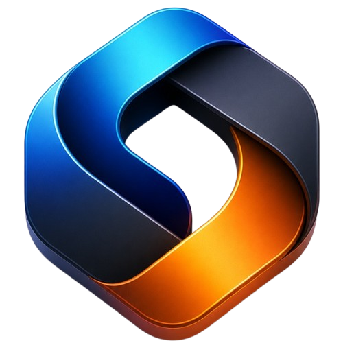

# Srifix Studios — Official Agency Website

<div align="center">



### We Transform Ideas Into Digital Experiences
**Next-generation digital production, obsessive visual standards, and category-defining brand narratives.**

[](https://react.dev/)
[](https://vitejs.dev/)
[](https://threejs.org/)
[](https://greensock.com/gsap/)
[](https://github.com/darkroomengineering/lenis)

[Live Demo](#) • [Explore Services](#services) • [Client Results](#testimonials) • [Get In Touch](#contact)

---

</div>

## 🌐 About Srifix Studios

**Srifix Studios** is an international digital production studio and creative agency. We bridge the gap between high-fashion digital art direction, interactive 3D spatial computing, and rigorous software engineering to build brands that outlive trends.

From category prestige brand identities to silky 60fps web applications and AI-accelerated workflows, every experience is meticulously engineered to feel inevitable.

---

## ✨ Website Architecture & Key Experiences

The Srifix Studios website is an immersive, interactive digital experience built with cutting-edge web technologies:

### 1. Interactive Chromatic Mouse Trail
- Real-time particle light trail (`MouseTrail.jsx`) following cursor movement with dynamic spectrum glow:
  $$\text{Cyan} \rightarrow \text{Blue} \rightarrow \text{Violet} \rightarrow \text{Purple} \rightarrow \text{Orange} \rightarrow \text{Gold}$$

### 2. NavIsland & Header Navigation
- Sticky floating navbar with frosted glassmorphism (`backdrop-filter: blur(20px)`).
- Dynamic scroll state detection, animated brand logo with radial sheen, pill menu navigation, and mobile hamburger drawer.

### 3. Hero Section (Version 5)
- Ambient video background loop delivering atmospheric depth.
- Display headline with high-contrast serif italic accent ("*Digital* Experiences") and subtle drop-shadow luminescence.
- **Key Metrics Info Bar:**
  - **120+** Projects Delivered
  - **40+** Countries Served
  - **98%** Client Satisfaction
  - **4.9/5** Average Client Rating

### 4. About Us Section (Version 5)
- Scrubbed rising background watermark ("ABOUT US") animated along the scroll axis via GSAP ScrollTrigger.
- Dual ambient glow orbs (deep cobalt blue & radiant amber).
- High-contrast flanking glassmorphic cards:
  - `01 / ART DIRECTION`: Obsessive visual standards, typographic rhythm, and complete brand systems.
  - `02 / ENGINEERING`: Production-grade architecture, buttery 60fps fluidity, and sub-second load times.
- Central studio partnership call-to-action button.

### 5. Services & 3D Interactive Brand Arena
- Interactive 3D brand mark built with `@react-three/fiber` and `@react-three/drei` featuring:
  - Real-time cursor tilt response
  - User drag-to-spin interaction
  - Smooth inertia and continuous subtle floating physics
- Multi-tier service showcases:
  - **Brand Identity**: Logo, design language, color theory, social media kit.
  - **UI/UX Design**: Wireframing, Figma design systems, conversion-driven user journeys.
  - **Web Development**: Webflow, custom modern stacks, SEO optimization from day one.
  - **Digital Marketing**: Meta & Google ad infrastructure, audience research, ROAS optimization.

### 6. "How We Work" Interactive Desk Lamp
- Custom SVG pull-cord desk lamp with dynamic spring physics and interactive light switch.
- Illuminates 4 sequential workflow phases on demand:
  1. **Discovery & Vision**: Brand architecture, competitive moats, market audit.
  2. **Art Direction & 3D**: Bespoke typography, motion assets, interactive prototypes.
  3. **Modern Engineering**: WebGL interfaces, buttery smooth animations, API integrations.
  4. **Launch & Expansion**: Performance tuning, analytics setup, continuous scaling.

### 7. Why Us (Honeycomb Intelligence)
- Multi-directional fly-in floating honeycomb cluster with live count-up animation metrics:
  - **48h**: Average first response time
  - **6**: Global delivery regions
  - **18**: Core creative & engineering services
  - **100%**: Remote-first global collaboration

### 8. Client Voice (Testimonials)
- 3D canyon zoom perspective with animated client cards and interactive star ratings.
- Real client case studies showcasing measurable conversion lifts and international impact across Finland, India, and Ukraine.

### 9. Services & Transparent Pricing
Official studio service tiers and structured deliverables:
- **01 Brand Identity (₹20,000 Starting)**: Logo design, brand style guide, color palette, typography system, business cards, social media kit.
- **02 UI/UX Design (₹25,000 Starting)**: Wireframes, Figma prototypes, website & mobile app UI design, UI flow, user journey mapping.
- **03 Web Development (₹30,000 Starting - Featured)**: Modern responsive website, WordPress / Webflow / custom code, SEO-friendly setup, speed optimization.
- **04 Digital Marketing (₹20,000+ / mo Starting)**: Google & Meta ads setup, campaign management, ad creatives, audience research, ROAS optimization.
- **05 Social Media Marketing (₹12,000+ / mo Starting)**: Content strategy, planning, creation, copywriting, 4 static posts, 4 carousels & 4 reels monthly.
- **06 Creative Design (As Per Requirement)**: Static posts (₹200), carousels (₹900), reels (₹2,000), posters (₹400), presentation decks (₹3,000).
- **Pricing Principle & Policy**: Clear scope definitions and quotation policies for custom enterprise deliverables.

### 10. Frequently Asked Questions (FAQ)
- Single-expand interactive accordion addressing engagement kickoffs, deliverables, post-launch maintenance, and global client logistics.

### 11. High-Impact Closing CTA & Studio Footer
- Glowing tubelight neon banner with guaranteed 1-business-day proposal turnaround.
- Studio dispatch newsletter signup, quick navigation links, social handles, and direct leads contact info.

---

## 🛠️ Technology Stack

| Layer | Technology |
|---|---|
| **Core Framework** | [React 18](https://react.dev/) + [Vite 5](https://vitejs.dev/) |
| **Motion & Orchestration** | [GSAP 3.12](https://greensock.com/gsap/) (ScrollTrigger, Timelines, MatchMedia) |
| **Smooth Scrolling** | [Lenis Smooth Scroll](https://github.com/darkroomengineering/lenis) |
| **3D & Spatial Computing** | [Three.js](https://threejs.org/) + [@react-three/fiber](https://docs.pmnd.rs/react-three-fiber/) + [@react-three/drei](https://github.com/pmndrs/drei) |
| **Icons** | [Lucide React](https://lucide.dev/) |
| **Typography** | `Syne`, `Playfair Display`, `Plus Jakarta Sans`, `Inter`, `Space Grotesk` |
| **Design System & CSS** | Modern Vanilla CSS with CSS Custom Properties, Glassmorphism & GPU Acceleration |

---

## 📁 Repository Structure

```text
Srifix-Studios-Website/
├── public/
│   ├── assets/
│   │   ├── about-us-title.svg     # Scalable typography watermark
│   │   ├── arrow-about.svg        # Action icon
│   │   ├── arrow-up-right.svg     # External link / CTA arrow
│   │   ├── favicon-logo.png       # Brand favicon & navmark
│   │   └── mini-info-bg.svg       # Subtle decorative background grid
│   └── client-voice-canyon.webp   # Client Voice portal backdrop
├── src/
│   ├── components/
│   │   ├── AboutUsSection.jsx     # Version 5 About Us with scrubbed watermark
│   │   ├── CtaSection.jsx         # High-conversion closing banner
│   │   ├── FaqSection.jsx         # Accordion FAQ
│   │   ├── FeaturesSection.jsx    # Services cards + 3D Logo container
│   │   ├── Footer.jsx             # Comprehensive studio footer
│   │   ├── HeroSection.jsx        # Version 5 Hero + NavIsland + Video background
│   │   ├── HowWeWork/             # Pull-cord desk lamp + process steps
│   │   ├── MouseTrail.jsx         # Interactive multi-color glowing cursor trail
│   │   ├── PricingSection.jsx     # Pricing plans grid
│   │   ├── TestimonialsSection.jsx# 3D perspective client testimonials
│   │   ├── ThreeCanvas/           # Three.js 3D interactive logo canvas
│   │   └── WhyUsSection.jsx       # Honeycomb count-up stats section
│   ├── data/
│   │   ├── pricing.js             # Pricing plans and FAQ data
│   │   └── workflow.js            # How We Work steps and deliverables
│   ├── hooks/
│   │   └── useLenis.js            # Lenis smooth scroll lifecycle hook
│   ├── styles/
│   │   ├── about.css              # About section styling
│   │   ├── animations.css         # Keyframe and transition utilities
│   │   ├── cta.css                # CTA and footer styles
│   │   ├── hero.css               # Hero and navigation styles
│   │   ├── howwework.css          # Interactive desk lamp physics styles
│   │   ├── mousetrail.css         # Glowing cursor trail styles
│   │   ├── pricing.css            # Pricing and FAQ styles
│   │   ├── sections.css           # Global layout and base styles
│   │   └── variables.css          # Design tokens (colors, fonts, glass tokens)
│   ├── App.jsx                    # Primary application layout
│   └── main.jsx                   # React DOM root entry point
├── index.html                     # HTML root template with Google Fonts preconnect
├── package.json                   # Project dependencies and scripts
└── vite.config.js                 # Vite bundler configuration
```

---

## 🚀 Quick Start

### Prerequisites
- [Node.js](https://nodejs.org/) (version 18.0.0 or higher recommended)
- `npm` (version 9.0.0 or higher)

### 1. Installation
Clone the repository and install dependencies:
```bash
git clone https://github.com/Srifix-Studios/Srifix-Studios-Website.git
cd Srifix-Studios-Website
npm install
```

### 2. Run Local Development Server
Start Vite's ultra-fast hot-reloading dev server:
```bash
npm run dev
```
Open [http://localhost:5173](http://localhost:5173) in your browser.

### 3. Production Build
Compile and bundle the project for production:
```bash
npm run build
```
Preview the production build locally:
```bash
npm run preview
```

---

## ⚡ Performance & Accessibility Highlights

- **Silky 60fps Animation:** All micro-interactions and scroll-scrubbed elements use CSS hardware transforms (`transform`, `opacity`) to eliminate layout thrashing.
- **Accessible Motion:** GSAP animations respect user motion preferences via `prefers-reduced-motion: no-preference` guards.
- **Adaptive Typography:** Utilizing `clamp()` for fluid scalability across mobile, tablet, desktop, and ultra-wide displays.
- **Lenis Smooth Scroll:** Synchronized with GSAP's `ScrollTrigger.update` for jitter-free momentum scrolling.

---

## 📬 Direct Studio Contact

Ready to build something premium? Contact the team directly:

- **Email:** [info@srifixstudios.com](mailto:info@srifixstudios.com)
- **Phone / WhatsApp:** [+91 9625038790](https://wa.me/919625038790)
- **Headquarters:** Srifix Studios LLC

---

<div align="center">
  <p>© 2026 Srifix Studios LLC. Engineered for the relentless. All rights reserved.</p>
</div>
